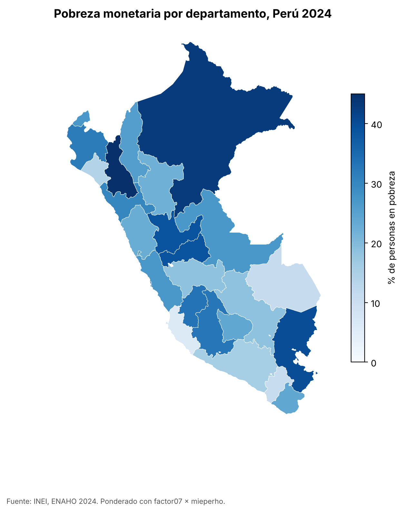
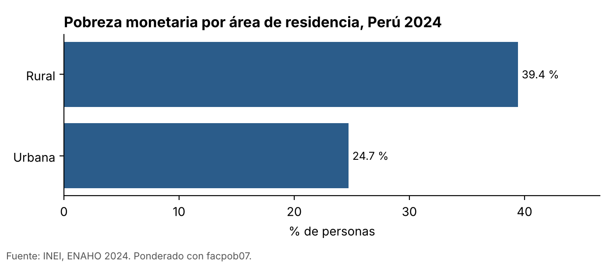

# Skills de Claude Code para la ENAHO 2024

Tres skills que convierten los módulos del INEI en una base limpia, gráficos y un mapa, siempre de la misma forma. Sesión 16 del curso *Python intermedio* (PUCP, d2cml-ai/Data-Science-Python).

| Skill | Entra | Sale |
|---|---|---|
| `limpiando-enaho` | `datos/966-Modulo34.zip`, `datos/966-Modulo02.zip` | `salidas/personas_2024.parquet`, `salidas/validacion.txt` |
| `graficando-enaho` | la base limpia y una pregunta (área, sexo, edad, departamento) | `figuras/*.png` |
| `mapeando-enaho` | la base limpia y el GeoJSON de 25 departamentos | `mapas/pobreza_departamento.png` (+ `.csv`) |

`graficando` y `mapeando` dicen «si no existe `salidas/personas_2024.parquet`, usa primero la skill limpiando-enaho», así que un solo pedido activa dos skills seguidas.

## Cómo usarlo

```bash
git clone <este repo> && cd <este repo>
uv sync
# Bajar los dos zip del INEI (966 = ENAHO 2024) a datos/
curl -L -o datos/966-Modulo34.zip https://proyectos.inei.gob.pe/iinei/srienaho/descarga/STATA/966-Modulo34.zip
curl -L -o datos/966-Modulo02.zip https://proyectos.inei.gob.pe/iinei/srienaho/descarga/STATA/966-Modulo02.zip
claude
> Haz un mapa de la pobreza por departamento
```

O sin Claude, los scripts directos:

```bash
uv run .claude/skills/limpiando-enaho/scripts/limpiar.py --anio 2024
uv run .claude/skills/graficando-enaho/scripts/graficar.py --por area
uv run .claude/skills/mapeando-enaho/scripts/mapear.py
```

El GeoJSON (`datos/peru_departamental_simple.geojson`) ya viene en el repo; los zip y los `.dta` no se suben por su tamaño.

## La validación

`salidas/validacion.txt`:

| Chequeo | Resultado | INEI |
|---|---|---|
| Residentes habituales | 108,664 | 108,664 |
| Pobreza (sumaria, `factor07 × mieperho`) | 27.58 % | 27.6 % |
| Pobreza extrema | 5.50 % | 5.5 % |
| Pobreza (personas, `facpob07`) | 27.53 % | |
| Llaves únicas, unión sin pérdidas, 25 departamentos | OK | |

El pipeline (`limpiar.py`): leer con `convert_categoricals=False` y llaves como texto → normalizar nombres (`aÑo` → `anio`) → filtrar residentes `(p204==1 & p205==2) | (p204==2 & p206==1)` → unir con `validate="m:1"` → construir `departamento = ubigeo[:2]`, `urbano = estrato <= 5`, `pobre = pobreza <= 2` → validar → guardar. Si un chequeo falla, el script sale con código 1 y la skill se detiene.

## Resultados



Más pobreza: Cajamarca 45.0 %, Loreto 43.0 %, Puno 39.9 %. Menos: Ica 6.0 %, Moquegua 11.0 %, Madre de Dios 11.1 %. Los 25 departamentos tienen dato y la unión es por código (`ubigeo[:2]` = `FIRST_IDDP`).



Otras figuras en `figuras/`: sexo, grupo de edad y departamento.

### Una decisión sobre los pesos

Los gráficos siguen la regla del curso y ponderan con `facpob07` en la base de personas. El mapa pondera como el INEI publica (un registro por hogar, `factor07 × mieperho`), para replicar exactamente las cifras de referencia. La diferencia entre ambos métodos es de 0.1 puntos en área (urbana 24.7 % frente a 24.8 %) y hasta 0.5 en algún departamento (Puno 40.4 % frente a 39.9 %). Está explicada en `.claude/skills/limpiando-enaho/reference.md`.

## Evaluación

Tres pedidos con y sin skills, con `claude -p`: ver [evaluacion.md](evaluacion.md).

## Estructura

```
.claude/skills/
  limpiando-enaho/   SKILL.md · reference.md · scripts/limpiar.py
  graficando-enaho/  SKILL.md · scripts/graficar.py
  mapeando-enaho/    SKILL.md · scripts/mapear.py
datos/      GeoJSON (los zip del INEI se bajan aparte)
salidas/    personas_2024.parquet · validacion.txt
figuras/    gráficos PNG a 200 dpi
mapas/      pobreza_departamento.png · .csv
evaluacion.md · README.md · pyproject.toml · uv.lock
```
