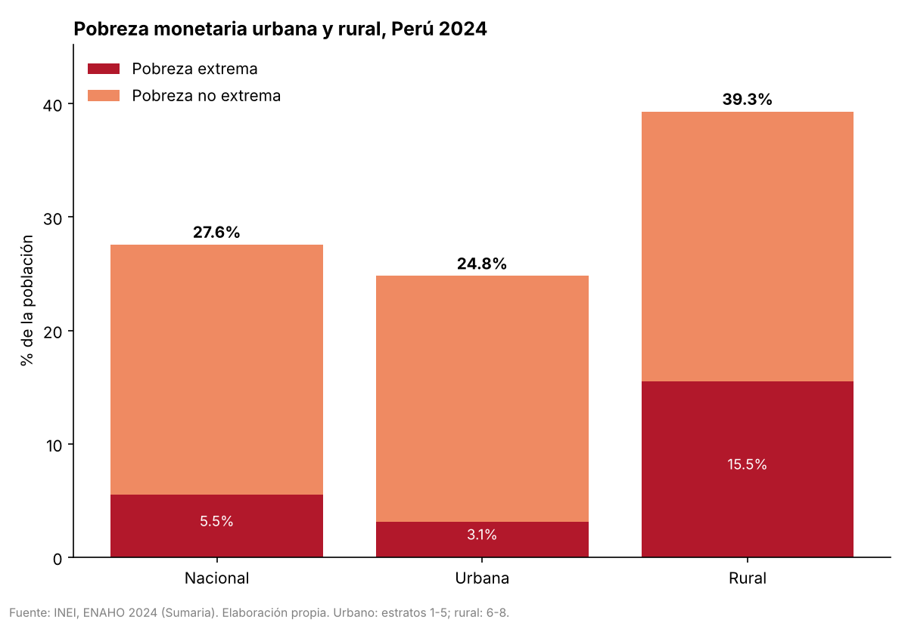
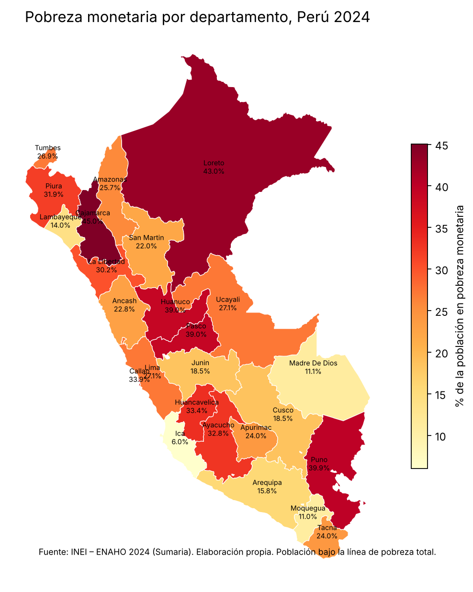

# Evaluación: tres pedidos con y sin skills

Cada pedido se corrió una vez con skills y una vez sin ellas, con `claude -p`, en copias limpias del repo (sin `salidas/`, `figuras/` ni `mapas/`; solo los zip del INEI y el GeoJSON en `datos/`).

```bash
claude -p "Haz un mapa de la pobreza por departamento con la ENAHO 2024"                          # con skills
claude -p --disallowedTools Skill "Haz un mapa de la pobreza por departamento con la ENAHO 2024"  # sin skills
```

En la copia sin skills además se borró `.claude/`, para que Claude no encontrara los scripts leyendo el repo. Fecha: 31 de octubre de 2026.

## Resultados

| Pedido | Debe salir | Con skills | Sin skills |
|---|---|---|---|
| ¿Cuál fue la pobreza en Cusco en 2024? | 18.5 % | **limpiando** · 18.5 % · validó 27.58 % · 25 s · USD 0.10 | No abrió los datos: intentó buscar en la web, no pudo y no dio cifra · USD 0.18 |
| Grafica la pobreza urbana y rural | 24.8 % y 39.3 % | **graficando → limpiando** · 24.7 % y 39.4 % (facpob07) · 27 s · USD 0.10 | 24.8 % y 39.3 % · barras apiladas de dos colores, sin validación · 41 s · USD 0.26 |
| Haz un mapa de la pobreza por departamento | Cajamarca 45.0 %, Ica 6.0 % | **mapeando → limpiando** · Cajamarca 45.0 %, Ica 6.0 %, 25 con dato · 26 s · USD 0.09 | Cajamarca 45.0 %, Ica 6.0 % · paleta amarillo-rojo que no empieza en 0, sin validación · 58 s · USD 0.30 |

## Qué se ve

- **Las skills se activaron solas y se encadenaron.** Los pedidos de gráfico y mapa activaron dos skills seguidas: la de gráfico o mapa, y luego `limpiando-enaho` porque no existía la base. Ningún pedido necesitó mencionar la skill.
- **Con skills, siempre ponderó y validó.** Las tres respuestas citan la validación (27.58 % frente a 27.6 % del INEI, 108,664 residentes) y dicen con qué peso calcularon.
- **Sin skills, el resultado depende de la suerte.** En Cusco ni siquiera miró `datos/`. En el gráfico y el mapa llegó a las cifras correctas usando solo la sumaria, pero eligió el diseño por su cuenta: barras apiladas de dos colores y un mapa amarillo-rojo cuya escala empieza en 6 %, no en 0. No armó la base de personas ni comprobó nada.
- **Con skills cuesta menos y tarda menos:** USD 0.09-0.10 y unos 26 s por pedido, frente a USD 0.18-0.30 y 14-58 s sin ellas, porque el script hace el trabajo y Claude solo lee lo que imprime.
- **Diferencia de 0.1 puntos en urbano/rural.** `graficando-enaho` pondera con `facpob07` por regla y da 24.7 % y 39.4 %; la referencia (24.8 % y 39.3 %) usa la sumaria con `factor07 × mieperho`. La skill lo advierte en su respuesta.

## Figuras sin skills (para comparar)

| Gráfico | Mapa |
|---|---|
|  |  |

Las versiones con skills están en `figuras/pobreza_area_2024.png` y `mapas/pobreza_departamento.png`.
